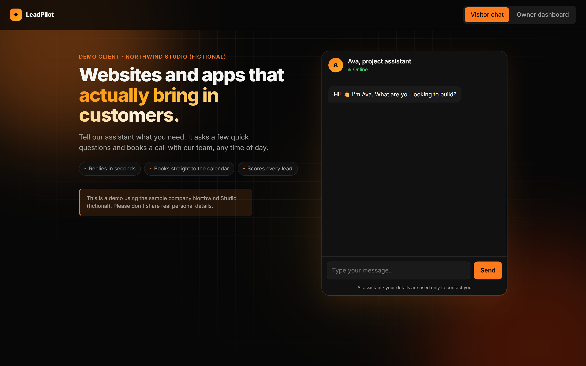
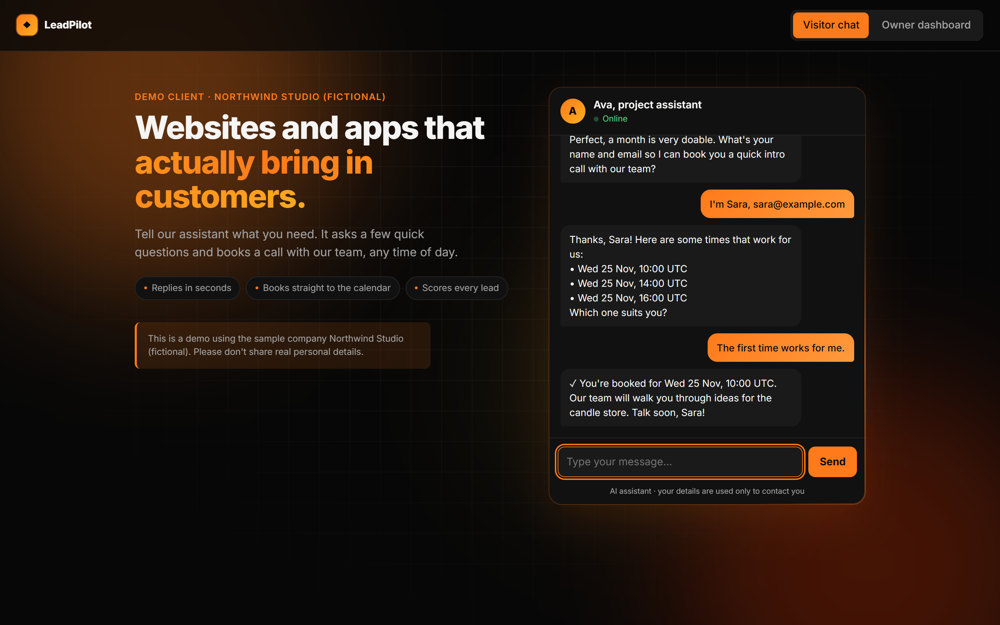
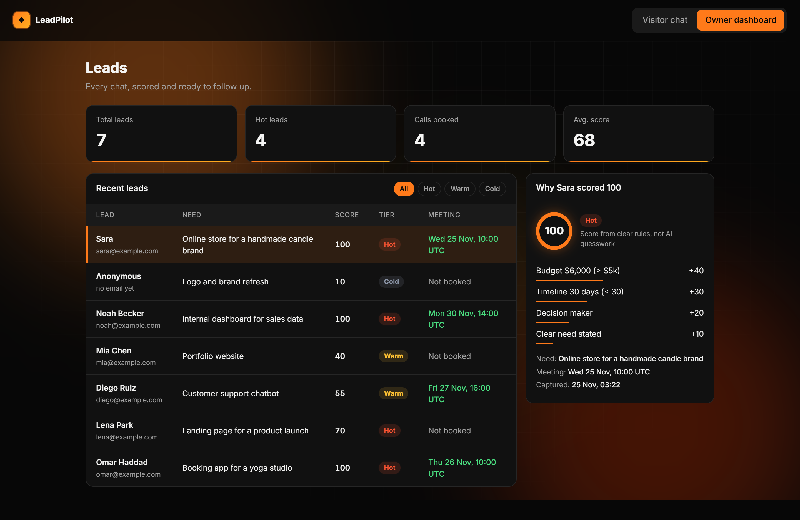
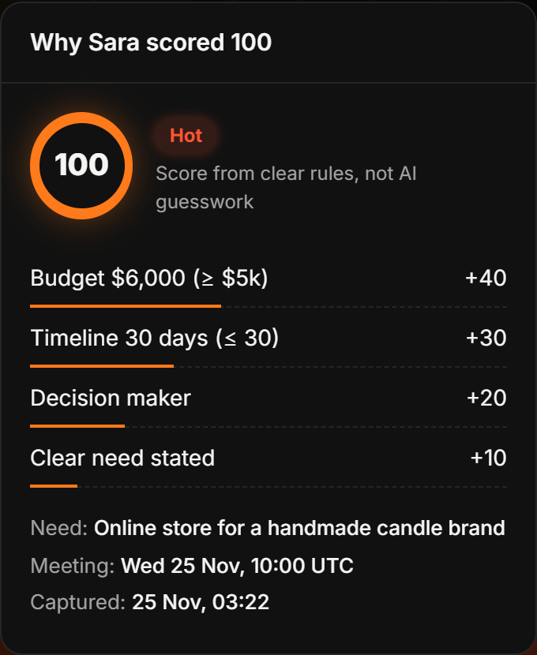
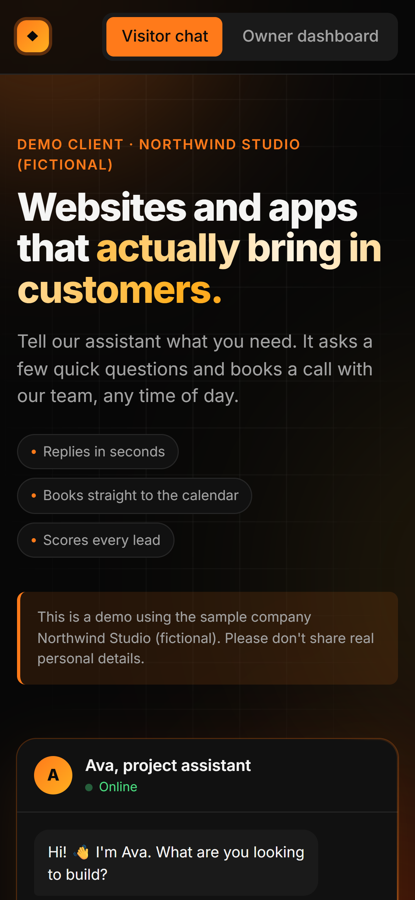
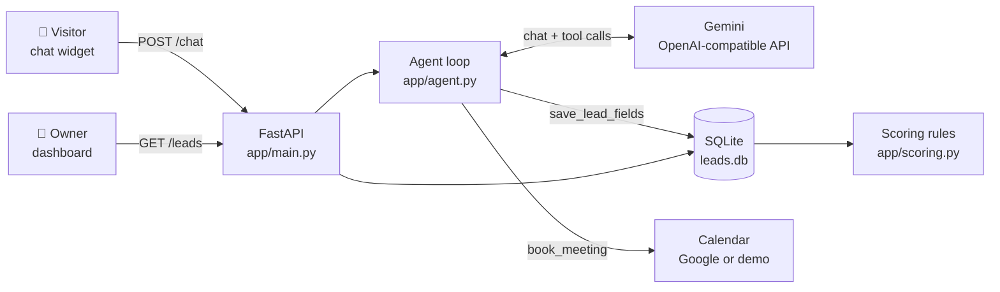
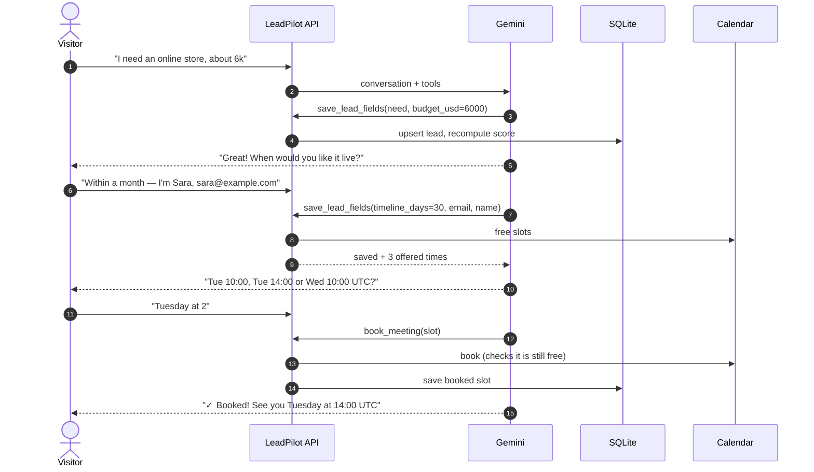
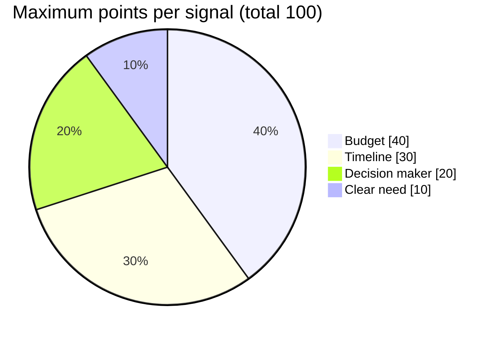
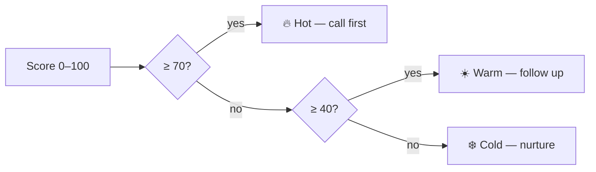

<div align="center">

# ◆ LeadPilot

**An AI sales assistant that chats with your website visitors, qualifies them, and books the call — while you sleep.**




</div>

---

## The problem

Most website visitors leave without saying a word. The ones who do message you wait hours for a reply, get asked the same five questions by hand, and half of them never book. Meanwhile you spend time on leads that were never going to buy.

## The solution

LeadPilot replies in seconds, any time of day. It asks a few friendly questions — **what they need, budget, timeline, and whether they decide** — saves the answers, scores the lead with clear rules, and **books a slot on your calendar** once it has a valid email. You open the dashboard and see who to call first, and *why*.

## Screenshots

<table>
  <tr>
    <td width="50%"><br><sub><b>Chat → qualified → booked.</b> The assistant asks one question at a time and offers real free slots. <i>(Scripted demo conversation: the replies are pre-written, while saving, scoring and booking ran through the real app code.)</i></sub></td>
    <td width="50%"><br><sub><b>Owner dashboard.</b> Every conversation becomes a scored lead with its meeting time.</sub></td>
  </tr>
  <tr>
    <td width="50%"><br><sub><b>Explainable scoring.</b> Each lead shows exactly where its points came from.</sub></td>
    <td width="50%" align="center"><br><sub><b>Works on phones.</b> Responsive layout, reduced-motion friendly.</sub></td>
  </tr>
</table>

> All people, emails and companies in the screenshots are fictional demo data.

## Features

- 💬 **Natural qualifying chat** — one friendly question at a time, budgets like "10k" or "$2,500" understood.
- 🎯 **Explainable lead scoring** — the AI only collects facts; plain, tested code does the math (hot / warm / cold).
- 📅 **Real booking** — offers actual free slots, catches double-booking, and books into Google Calendar (or a built-in demo calendar).
- 📊 **Owner dashboard** — live stats, tier filters and a per-lead score breakdown.
- 🔐 **Key-safe by design** — your API key stays in `.env` on your machine; never logged, stored or sent to the browser.
- 🔁 **Provider-agnostic** — Gemini by default, or any OpenAI-compatible API (Groq, NVIDIA, OpenAI) by changing three lines.

## How it works

### Architecture



### What happens in one conversation



### Lead scoring

The model never decides the score. It only extracts facts; this table (in [`app/scoring.py`](app/scoring.py)) turns them into points, so every score can be explained to a client.



| Signal | Points |
| --- | --- |
| Budget ≥ $5,000 / ≥ $1,000 / below | 40 / 25 / 5 |
| Timeline ≤ 30 days / ≤ 90 days / longer | 30 / 15 / 5 |
| Decision maker / not the decision maker | 20 / 5 |
| Need described | 10 |

Unknown values score 0.



## Tech stack

| Layer | Tools |
| --- | --- |
| Backend | Python 3.11+, FastAPI, Uvicorn, Pydantic |
| AI | Google Gemini via the `openai` SDK (OpenAI-compatible endpoint), function / tool calling |
| Data | SQLite (standard library) |
| Calendar | Google Calendar API (service account) or a built-in demo calendar |
| Frontend | Plain HTML, CSS and JavaScript — no build step, animated black-and-orange UI |
| Tests | pytest, FastAPI TestClient — 79 tests, no network needed |

## Project structure

```
leadpilot/
├── app/
│   ├── main.py        # FastAPI routes: /chat, /leads, static UI
│   ├── agent.py       # Tool-calling loop, prompt, input validation
│   ├── llm.py         # OpenAI-compatible client (Gemini by default)
│   ├── scoring.py     # Deterministic lead scoring rules
│   ├── store.py       # SQLite lead store
│   ├── calendars.py   # Demo calendar + Google Calendar
│   └── config.py      # Settings from .env (key never printed)
├── static/            # Chat widget + owner dashboard
├── tests/             # 79 tests with a stub model and fake calendar
├── design/mockup.html # Original UI design
└── .env.example       # Copy to .env and add your own key
```

## Run it yourself

You need **Python 3.11+** and a free **Gemini API key**.

**1. Install**

<details open>
<summary>Windows PowerShell</summary>

```powershell
python -m venv .venv
.venv\Scripts\Activate.ps1
pip install -r requirements.txt
Copy-Item .env.example .env
```
</details>

<details>
<summary>macOS / Linux</summary>

```bash
python3 -m venv .venv
source .venv/bin/activate
pip install -r requirements.txt
cp .env.example .env
```
</details>

**2. Add your key**

1. Go to <https://aistudio.google.com/apikey> and click **Create API key**.
2. Open `.env` and paste it after `LLM_API_KEY=` (no quotes).
3. Set `LLM_MODEL=` to a current **Flash** model ID. In AI Studio, open a chat and click **Get code** to see the exact ID. A wrong ID gives `NotFoundError (status 404)`.

**3. Start**

```
uvicorn app.main:app --reload
```

Open <http://localhost:8000>, chat as a visitor, then switch to the **Owner dashboard** tab.

Without a key the server still runs, and the chat tells you it isn't configured yet.

## Keep your key safe

- Your key lives only in `.env`, which is git-ignored. Never commit it, paste it into an issue, or show it in a screenshot.
- The app never logs the key, never sends it to the browser, and never stores it in the database.
- If a key ever leaks, delete it in AI Studio and create a new one.

## Switching providers

Any provider with an OpenAI-compatible API works. Change `LLM_BASE_URL`, `LLM_API_KEY` and `LLM_MODEL` in `.env`. Groq, NVIDIA and OpenAI all work this way. The model must support **tool calling**, because the assistant saves leads and books meetings through tools.

## Guardrails

- A meeting is only booked after a valid email is captured, and only one booking per chat.
- Messages are limited to 1,000 characters; empty messages are rejected.
- Each chat is capped at 20 visitor messages to protect a free-tier quota; after that the bot still saves an email if one is given.
- Provider errors (bad key, quota) show the visitor a friendly fallback, never the raw error. Logs record only the error type and status code.
- Everything the model sends to a tool is validated; bad input becomes an error the model can recover from.
- The assistant only discusses qualifying and booking, never reveals its instructions, and has no tool that can read other leads.
- All visitor text is rendered as plain text in the dashboard, so it cannot inject HTML or scripts.

## Google Calendar (optional)

Without setup, LeadPilot uses a demo calendar. To book into your real one:

1. In Google Cloud, create a service account, enable the Google Calendar API, and download the service account JSON key.
2. Save it outside git (for example `credentials.json`, which is git-ignored) and set `GOOGLE_CREDENTIALS_FILE` in `.env` to its path.
3. In Google Calendar, open your calendar's **Settings and sharing**, share it with the service account's email, and choose **Make changes to events**.
4. Copy the **Calendar ID** from the same page (usually your Gmail address) into `GOOGLE_CALENDAR_ID` in `.env`.

Meetings are 30 minutes, in UTC, on weekdays at 10:00, 14:00 and 16:00. If Google can't read the calendar's free/busy data, LeadPilot refuses to offer times rather than guessing.

## Limitations

- **No login on `/leads` or the dashboard.** Add authentication before using this with real clients.
- Chat sessions live in memory and reset when the server restarts.
- Leads are stored in a local SQLite file (`leads.db`, git-ignored).
- Demo-calendar bookings reset when the server restarts (saved leads keep their booked time).
- Typing an email that already belongs to a lead updates that lead.
- The Gemini free tier allows only a few requests per minute; a busy demo will show the friendly fallback when the limit is hit. On the free tier Google may use prompts to improve its models, so use demo data only.

## Running the tests

```
python -m pytest
```

The tests use a stub model and a fake calendar. They never touch the network or need a key.

---

<div align="center">

Built by [@ziadbin09](https://github.com/ziadbin09) · Python · FastAPI · Gemini

</div>
